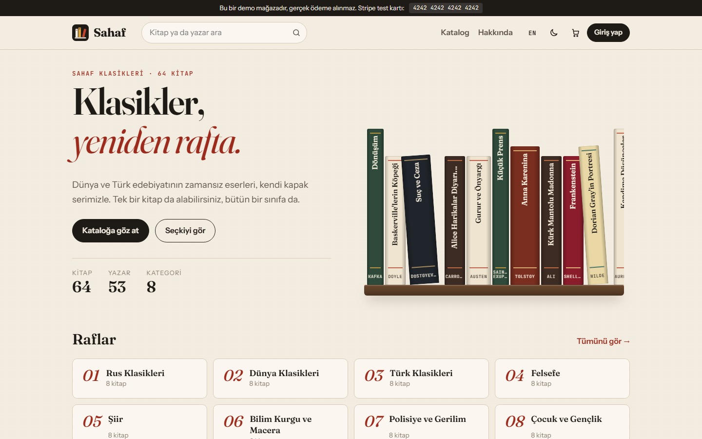
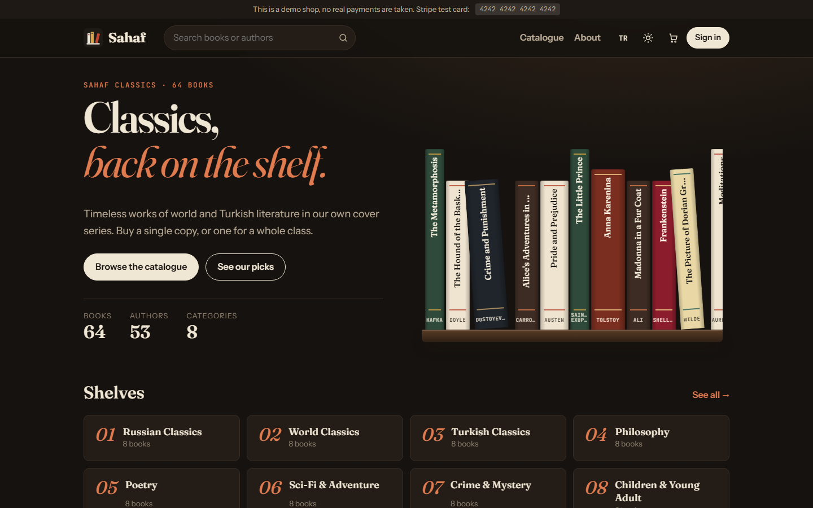
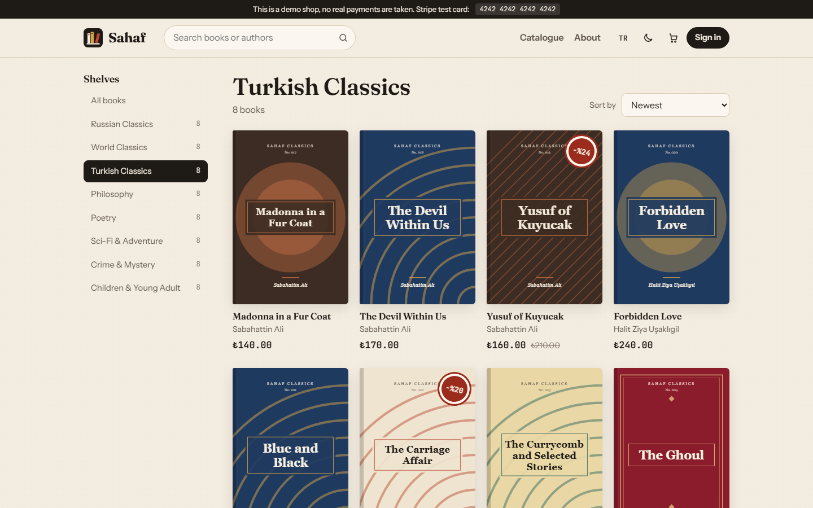
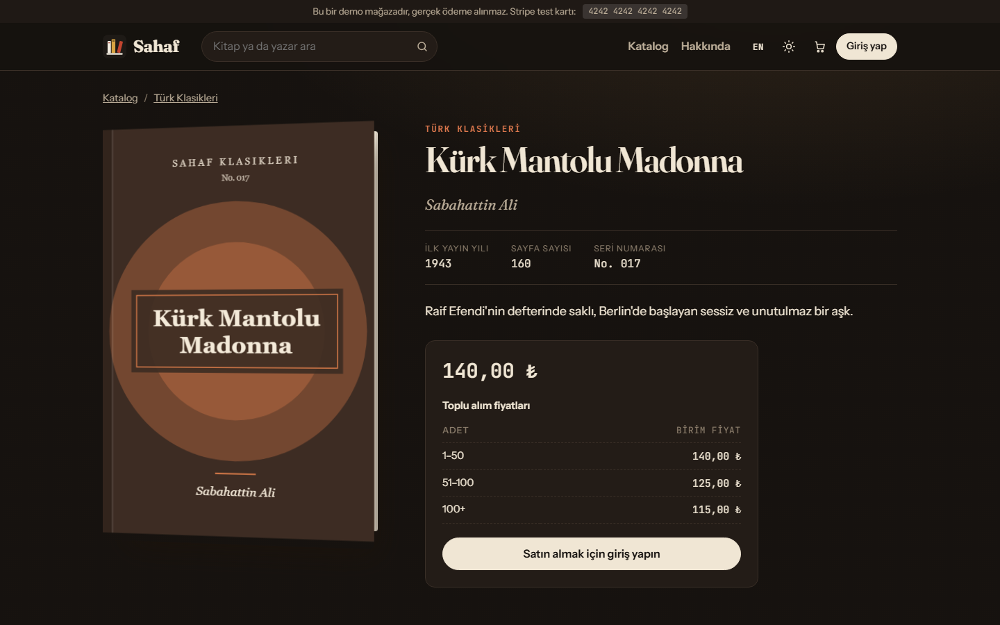
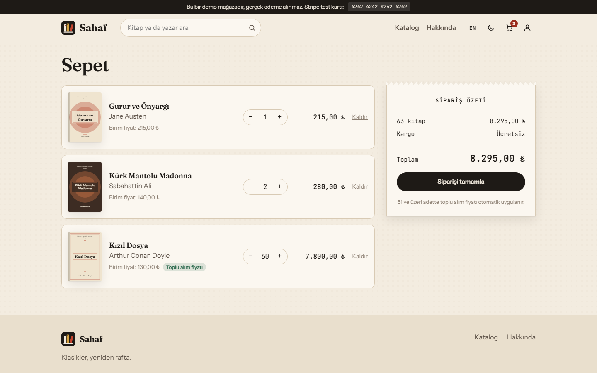
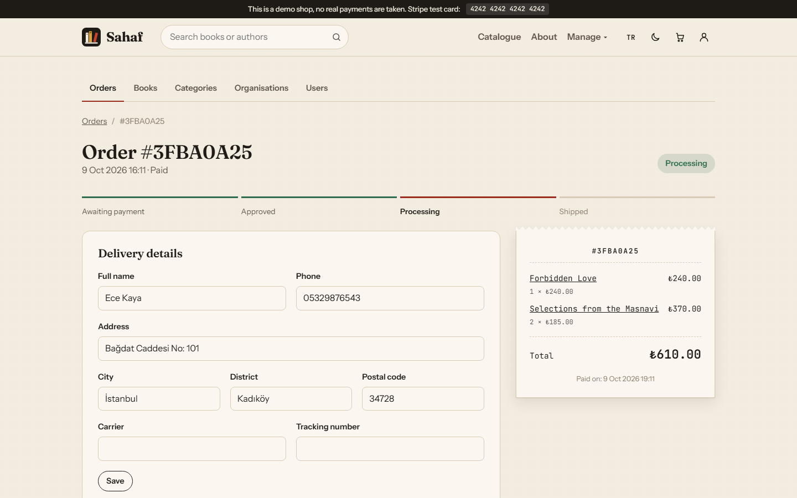
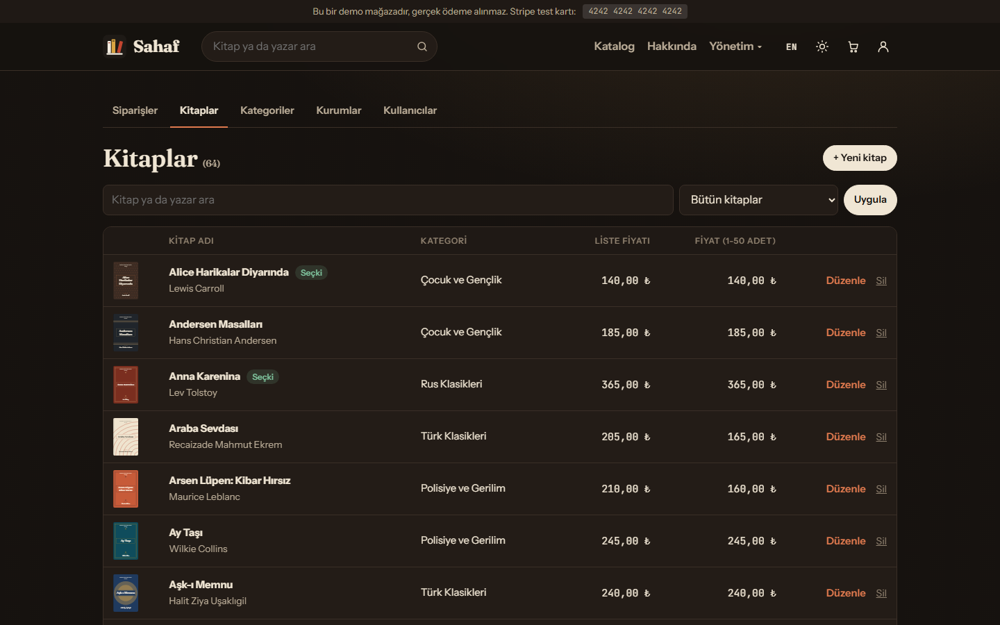
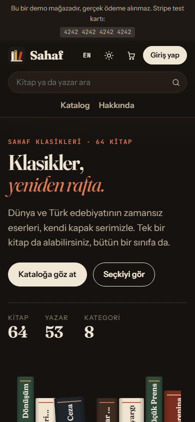

# Sahaf

[English](README.md) | **Türkçe**

ASP.NET Core MVC ile yazılmış bir çevrim içi kitapçı. Sahaf, telifi sona ermiş klasikleri kendi kapak serisiyle satar: müşteriler kataloğa göz atar, sepeti doldurur ve Stripe ile öder; okullar toplu sipariş verip sonra öder; çalışanlar mağazayı yönetim panelinden yönetir. Bütün kapakları uygulamanın kendisi çizer.

**Canlı demo:** [sahaf.miracdeprem.com](https://sahaf.miracdeprem.com). Ödemeler Stripe test modunda alınır; `4242 4242 4242 4242` kartını, ileri bir tarihi ve herhangi bir CVC'yi kullanabilirsiniz. Site ücretsiz bir sunucuda çalıştığı için bir süre kullanılmadıysa ilk sayfa yarım dakika kadar sürebilir.



## Özellikler

**Mağaza**
- 8 kategoride 64 klasik; ada ya da yazara göre arama, kategori filtresi, beş sıralama seçeneği ve sayfalama
- Toplu alım fiyat kademeleri (1-50, 51-100, 100+ adet) ve aynı raftan kitaplar gösteren kitap sayfaları
- Üretilen kapaklar: her kitabın kendine ait renkleri ve deseni var; görsel dosyasına ya da kapak telifine gerek yok
- Adet değiştirme, otomatik toplu alım fiyatı ve fiş görünümünde özet içeren sepet
- Stripe ile ödeme; sipariş hem imzalı webhook hem dönüş sayfasındaki kontrolle onaylanır
- Kurum hesapları (ör. okullar) siparişi hemen verir, 30 gün içinde öder; sonradan "Şimdi öde" butonu
- Durum zaman çizelgeli sipariş geçmişi; ödeme alındığında ve kargoya verildiğinde e-posta

**Hesaplar**
- E-posta doğrulamalı kayıt, beş hatalı denemede kilitlenen giriş, şifre sıfırlama
- Kayıtlı teslimat adresi ödeme formunu otomatik dolduran profil
- Şifre değişince diğer cihazlardaki oturumlar kapanır; hesap silinebilir

**Yönetim paneli**
- Kitap, kategori ve kurum: ekle, düzenle, sil (başka kayıtlar bağlıysa silme engellenir)
- Tür, boyut ve içerik kontrollü görsel yükleme; kapak seçme ya da üretilen kapağa dönme
- Siparişler: hazırlamaya başla, kargo firması ve takip numarasıyla kargola, Stripe üzerinden iptal ve iade
- Kullanıcılar: kilitle, kilidi aç, rol değiştir (müşteri, kurum, çalışan, yönetici); değişiklik anında geçerli
- Çalışanlar sadece siparişleri, yöneticiler her şeyi yönetir

**Her yerde**
- Türkçe ve İngilizce arayüz, açık "kâğıt ve mürekkep" teması ve koyu "okuma lambası" teması
- Telefonda çalışır; menüler ve formlar JavaScript olmadan da çalışır

## Ekran Görüntüleri

| | |
|---|---|
|  |  |
|  |  |
|  |  |

<p align="center"></p>

## Kullanılan Teknolojiler

- **C# / ASP.NET Core MVC**: Razor view'lar, area'lar (Customer, Admin, Identity) ve tag helper'lar
- **Entity Framework Core** ve **PostgreSQL** (Npgsql); repository ve unit of work katmanları
- **ASP.NET Core Identity**: hesaplar, roller, kilitleme ve token'lar
- Ödeme için **Stripe Checkout** ve webhook, e-posta için **Resend**
- Sade CSS ve az miktarda JavaScript; frontend framework'ü yok
- Testler için **xUnit**
- **Render** üzerinde **Docker**, veritabanı **Neon**'da

## Kurulum ve Çalıştırma

[sahaf.miracdeprem.com](https://sahaf.miracdeprem.com) adresini açın ya da yerelde çalıştırın. Güncel .NET SDK ve PostgreSQL gerekir.

```bash
git clone https://github.com/MrcDprm/sahaf-bookstore.git
cd sahaf-bookstore
```

`src/Sahaf.Web/appsettings.Development.json` dosyasındaki geliştirme bağlantısı `localhost:5432` adresine, `postgres` kullanıcısı ve `postgres` şifresiyle bağlanır; veritabanınız farklıysa değiştirin. Sonra ilk yönetici hesabını belirleyip uygulamayı başlatın (PowerShell):

```powershell
$env:Admin__Email = "admin@example.com"
$env:Admin__Password = "GucluBirSifre123"
dotnet run --project src/Sahaf.Web
```

İlk açılışta uygulama tabloları, rolleri, yönetici hesabını ve 64 kitabı kendisi oluşturur. `http://localhost:5080` adresini açın. Resend anahtarı yoksa e-postalar konsola yazılır; doğrulama bağlantısını oradan açabilirsiniz. Ödeme için `Stripe__SecretKey` alanına bir Stripe test anahtarı (webhook için `Stripe__WebhookSecret`) gerekir. Bütün ayarlar [.env.example](.env.example) dosyasında.

Testleri çalıştırmak için:

```bash
dotnet test
```

### Proje yapısı

```
src/
  Sahaf.Models/       Varlıklar ve view model'ler
  Sahaf.DataAccess/   DbContext, migration'lar, repository'ler, başlangıç verisi
  Sahaf.Utility/      Fiyatlama, sipariş akışı, kapak üretici, görsel kontrolü, e-posta
  Sahaf.Web/          Controller'lar, view'lar, yerelleştirme, Stripe, güvenlik ayarları
tests/
  Sahaf.Tests/        Birim testleri
Dockerfile            Render'da kullanılan konteyner
render.yaml           Render servis tanımı
```

### Güvenlik

- Şifreler Identity ile hash'lenir; en az 10 karakter, büyük harf, küçük harf ve rakam zorunlu
- Giriş için e-posta doğrulaması gerekir; beş yanlış şifre hesabı 15 dakika kilitler
- Giriş, kayıt ve şifre formlarında rate limiting var; bütün formlar CSRF'e karşı korumalı
- Formlar sadece izin verilen alanları kopyalar; fiyat, sahip ve durum formdan gönderilemez
- Kullanıcılar sadece kendi sepet satırlarına ve siparişlerine erişebilir; sipariş, sepet ve görsel id'leri tahmin edilemez
- Yüklenen görseller ilk byte'larına ve boyutuna göre kontrol edilir, `nosniff` ile sunulur
- Stripe webhook'u geçerli imzası olmayan her isteği reddeder
- Content Security Policy, HSTS ve diğer güvenlik başlıkları; CORS kapalı
- Gizli bilgiler sadece ortam değişkenlerinde; production'da kullanıcı dostu hata sayfaları, asla stack trace

## Öğrendiklerim

- **Bir kurs projesini ürüne çevirmek.** Sahaf, Udemy'de bir ASP.NET Core MVC kursunu takip ederken yazdığım kitapçı olarak başladı. Katmanlı yapısını (modeller, veri erişimi, yardımcılar, web) ve repository ile unit of work desenini korudum; geri kalanını yeniden kurdum: yeni veritabanı, ödeme, sipariş yönetimi, iki dil ve yeni tasarım.
- **Overposting.** Model binding, istekte bulduğu her özelliği doldurur. Bir müşteri sipariş tutarını 1 olarak, bir yönetici de yeni bir oluşturulma tarihi gönderebilirdi. Artık her form sadece ihtiyacı olan alanları alıyor, izinli alanlar kayıtlı nesneye kopyalanıyor; korunan alanları göndermeyi deneyen testler de yazdım.
- **Sadece girişi değil, sahipliği kontrol etmek.** `[Authorize]` bana sadece kullanıcının kim olduğunu söylüyor. Kurstaki sürümde URL'deki id değiştirilerek başkasının sepeti değiştirilebiliyordu. Artık her sepet ve sipariş işlemi kaydı kullanıcının id'siyle birlikte arıyor ve bu işlemler sadece POST kabul ediyor.
- **Güvenilebilir ödeme.** Tarayıcının Stripe'tan dönüşü taklit edilebilir ya da hiç gerçekleşmeyebilir; bu yüzden sipariş Stripe'ın webhook'uyla da onaylanıyor. Webhook imzasını doğruluyorum, oturumu siparişle eşleştiriyorum ve "ödendi" adımını iki kez çalışsa da sorun çıkarmayacak şekilde yazdım.
- **Rol değişikliği ne zaman geçerli olur?** Roller giriş cookie'sinde saklanıyor ve Identity bunu varsayılan olarak 30 dakikada bir kontrol ediyor. Kilitlenen bir kullanıcı siteyi kullanmaya devam edebiliyordu. Güvenlik damgasını her istekte kontrol edince kilit ve rol değişiklikleri anında geçerli oldu.
- **Kaynak dosyası olmadan yerelleştirme.** İki JSON dosyasını okuyan küçük bir `IStringLocalizer` yazdım. Doğrulama mesajlarını ve alan adlarını da çeviriyor; bir test iki dilde anahtarların ve yer tutucuların aynı olduğunu kontrol ediyor.
- **.NET'i ücretsiz barındırmak.** Vercel .NET çalıştırmadığı için uygulamayı Render için Docker'la paketledim, PostgreSQL için Neon kullandım. Uygulamanın önündeki proxy'yi yönetmeyi (forwarded header'lar, 443 portunda HTTPS), yayınlar arasında oturumlar düşmesin diye cookie anahtarlarını veritabanında tutmayı ve sunucunun diski silindiği için görselleri veritabanında saklamayı öğrendim.

## Gelecek Planları

- Stok takibi ve tükenen kitaplar
- Kitabı satın alan müşterilerden yorum ve puan
- İstek listesi ve indirim bildirimi
- Hesap e-postasını değiştirme ve iki adımlı giriş
- Veritabanındaki cookie anahtarlarını şifreleme
- Yönetim panelinde satış raporları

## Kaynaklar

- Kitaplar telifi sona ermiş klasiklerdir; açıklamalar, kapaklar ve fiyatlar bu demo mağaza için hazırlandı.
- Ana sayfadaki alıntı, Jane Austen'ın *Gurur ve Önyargı* (1813) romanının ilk cümlesidir.

## Lisans

[MIT](LICENSE)
